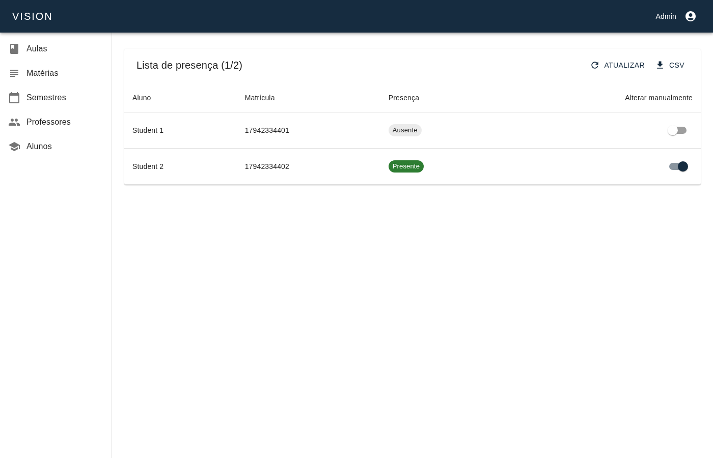
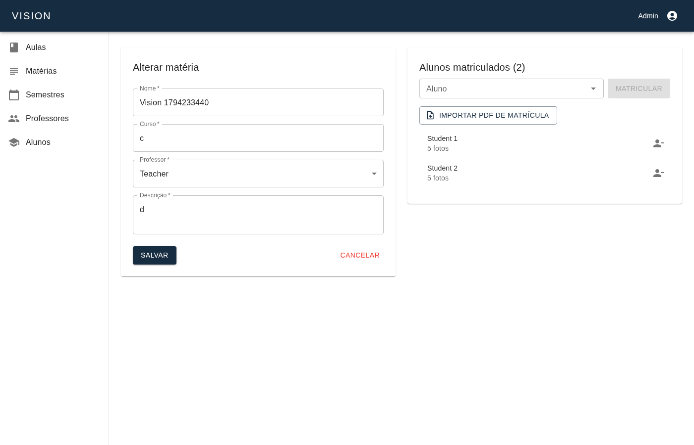
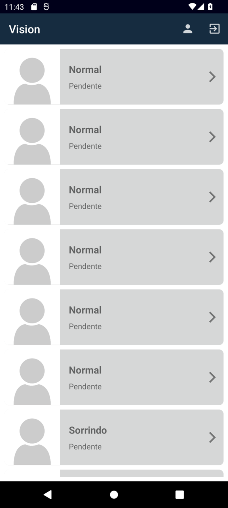
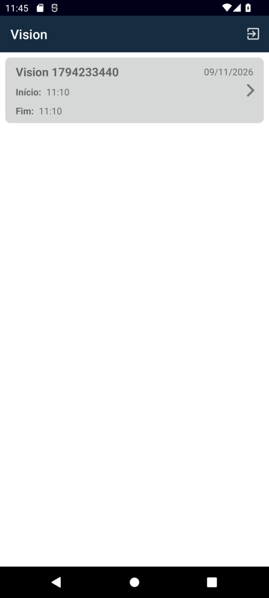

# Vision

Vision takes classroom attendance with face recognition. Students sign up in the Android app and take 30 photos of their face. Teachers open a class in the app and point the camera at each student: the app finds the face, the API recognizes it and marks the student present. Admins manage semesters, subjects, classes and enrollments in a web panel.

It started as my undergraduate final project (TCC) at UDESC in 2020 and was brought back in 2026 as a portfolio piece: dependencies updated, security holes closed, everything containerized and self-hosted.

| Web panel | | Android app | |
|---|---|---|---|
|  |  |  |  |

## How it fits together

```
Android app ──► detects and crops the face on the phone (OpenCV)
     │
     ▼
vision-server ──► trains one model per subject and recognizes faces (OpenCV, Python)
     ▲              Node, Express, TypeORM, Postgres
     │
vision-web ─────► admin and teacher panel (React, MUI)
```

| Repository | What it is |
|---|---|
| [vision-server](https://github.com/open-face-recognition-system/vision-server) | API, recognition and the Docker stack that runs everything locally |
| [vision-web](https://github.com/open-face-recognition-system/vision-web) | Web panel served by nginx |
| [vision-mobile](https://github.com/open-face-recognition-system/vision-mobile) | Android app for students and teachers |
| [cross-validation](https://github.com/open-face-recognition-system/cross-validation) | K-fold evaluation of the recognizers |

## How well it recognizes

The cross-validation repository compares Eigenfaces, Fisherfaces and LBPH. On the public LFW dataset, LBPH is the best of the three, recognizing 64% of faces in a group of 34 people with 30 photos each, and 77% in a group of 5. That is the weakest part of the project, and the next step is evaluating a neural recognizer (YuNet + SFace) in [cross-validation#6](https://github.com/open-face-recognition-system/cross-validation/issues/6).

## Running it

Clone `vision-server` and `vision-web` side by side and run `docker compose up -d --build` in `vision-server`. The panel opens on `http://localhost:8080`. Images are published to Docker Hub as `mariofronza/vision-server` and `mariofronza/vision-web`, and the Android APK is attached to `vision-mobile` releases.
